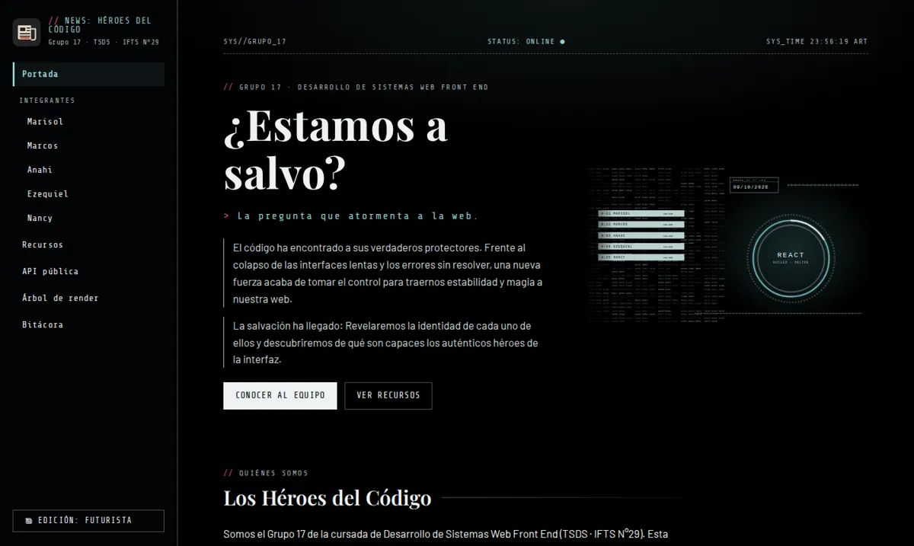
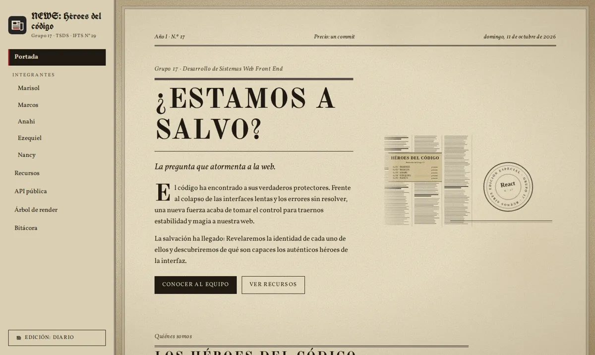
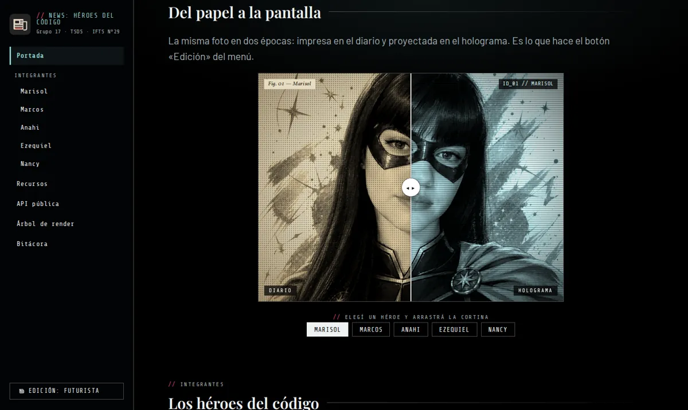
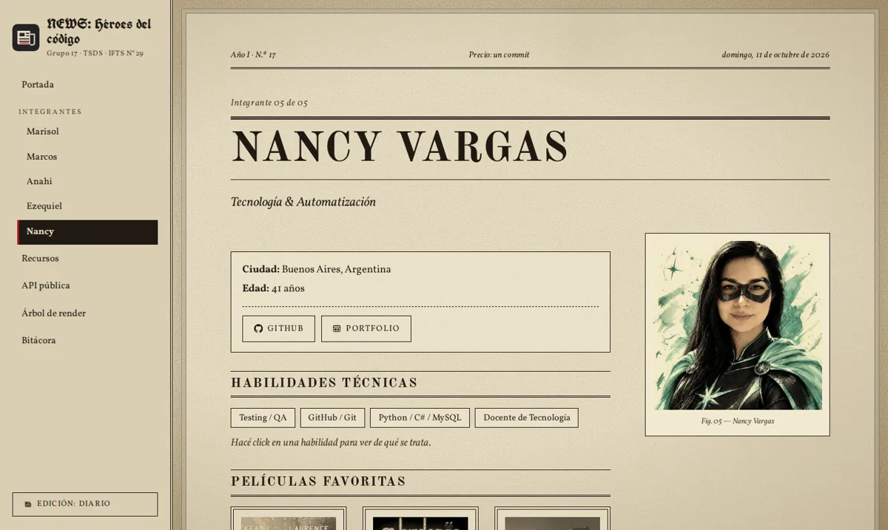
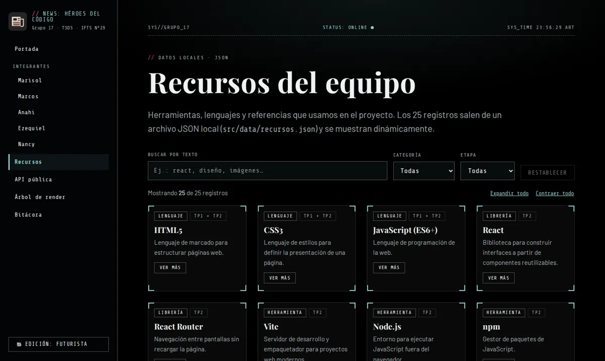
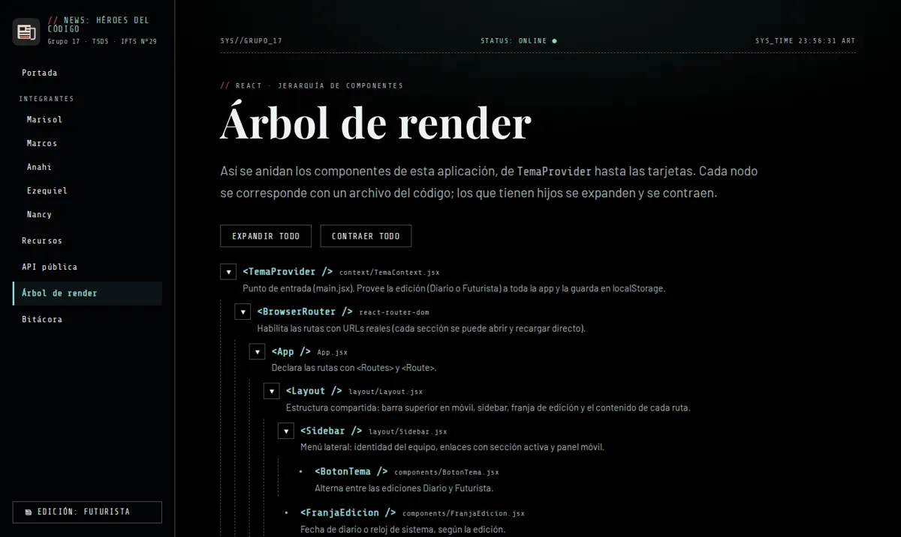

# Los Héroes del Código · TP2 

**Desarrollo de Sistemas Web Front End · TSDS · IFTS N°29 · Ciclo 2026 · Grupo 17**

Docente: [Martínez, Luciano](https://lucianomartinez.ar/)

Aplicación React que continúa el proyecto del [TP1](https://los-heroes-del-codigo.vercel.app/)
Presenta al equipo y reúne sus perfiles, recursos, una consulta a una API pública, el árbol de componentes y la bitácora del proceso.

## Índice

1. [Descripción del proyecto](#descripción-del-proyecto)
2. [Aplicación publicada](#deploy)
3. [Integrantes y responsabilidades](#integrantes)
4. [Capturas](#capturas)
5. [Secciones e interacciones](#secciones-de-la-aplicación)
6. [Identidad visual y accesibilidad](#identidad-visual)
7. [Tecnologías](#tecnologías)
8. [Estructura del proyecto](#estructura-del-proyecto)
9. [Trabajo en equipo](#cómo-trabajamos-en-equipo)
10. [Instalación y ejecución](#cómo-ejecutarlo)
11. [Declaración de uso de IA](#declaración-de-uso-de-ia)
12. [Créditos](#créditos)

## Descripción del proyecto

«Los Héroes del Código» es la aplicación del Grupo 17. La portada presenta al equipo y propone un pequeño juego visual, **«Del papel a la pantalla»**: una cortina que se arrastra para pasar de la foto impresa en un diario viejo a su versión en un holograma futurista. Desde ahí se accede a los perfiles de los cinco integrantes y al resto de la aplicación, que se recorre siempre desde una **sidebar compartida**: perfiles, un catálogo de recursos con búsqueda y filtros, una consulta a una API pública, el árbol de componentes de la propia aplicación y la bitácora del proceso de trabajo.

La aplicación tiene **dos ediciones** que se alternan con el botón del menú lateral:

* **Diario:** estética de periódico antiguo, con papel envejecido y tinta.
* **Futurista:** estética de revista de ciencia ficción, inspirada en las interfaces holográficas de **Ghost in the Shell**, con fondo negro, titulares destacados y acentos de color.

Si no hay una preferencia guardada, la edición inicial se adapta al modo claro u oscuro del sistema.

## Aplicación publicada

* **Sitio publicado en Vercel:** [https://los-heroes-del-codigo-tp2.vercel.app](https://los-heroes-del-codigo-tp2.vercel.app/)
* **Repositorio:** [https://github.com/LuNanVarg/los-heroes-del-codigo-tp2](https://github.com/LuNanVarg/los-heroes-del-codigo-tp2)
* **Proyecto anterior (TP1):** [https://los-heroes-del-codigo.vercel.app](https://los-heroes-del-codigo.vercel.app/)

## Integrantes

| Integrante | Perfil de GitHub | Responsabilidad en el TP2 |
|---|---|---|
| Alcaraz, Marisol | [Marisol14](https://github.com/Marisol14) | Títulos y descripciones de cada sección: hook `src/hooks/useTitulo.js`. |
| Artine, Marcos | [MarcosArtine](https://github.com/MarcosArtine) | Catálogo de recursos: `src/data/recursos.json`. |
| Cardozo, Anahi | [anniecpk](https://github.com/anniecpk) | Ícono del botón hamburguesa del menú móvil: `src/components/IconoHamburguesa.jsx`. |
| Cattalín, Ezequiel | [nilattac](https://github.com/nilattac) | Pruebas automáticas de la consulta a la API: `src/tests/tvmaze.test.js`. |
| Vargas, Nancy | [LuNanVarg](https://github.com/LuNanVarg) | Base de la aplicación y de las dos ediciones (con IA), README, bitácora, documentación y entrega. |

Cada integrante trabaja en su propio archivo.

## Capturas

| | |
|---|---|
| <br>**Portada · Futurista** | <br>**Portada · Diario** |
| <br>**«Del papel a la pantalla»** | <br>**Perfil · Diario** |
| <br>**Recursos · Futurista** | <br>**Árbol de render · Futurista** |

## Secciones de la aplicación

| Ruta | Sección | Qué contiene |
|---|---|---|
| `/` | Portada | Presentación del equipo, revelador interactivo, tarjetas de integrantes y accesos a las demás secciones. |
| `/integrantes/:slug` | Perfiles (×5) | Un único componente `Perfil` que arma cada perfil a partir de sus datos. Cada perfil suma una interacción propia (ver abajo). |
| `/recursos` | Datos locales (JSON) | al menos 25 registros de `src/data/recursos.json`, con búsqueda por texto, filtros por categoría y etapa, desplegable por registro, aviso sin resultados y botón para restablecer. |
| `/api` | API pública | Consulta a la API de [TVmaze](https://www.tvmaze.com/api) con mensaje de carga, mensajes de error específicos (404, 429, servidor caído, sin conexión) y un tiempo máximo de espera de 8 segundos, y botones para reintentar y actualizar. |
| `/arbol` | Árbol de renderizado | Jerarquía real de componentes, con nodos que se expanden y se contraen. |
| `/bitacora` | Bitácora | Registros del TP1 y del TP2, con filtro por etapa y desplegables. |


**Interacciones de cada perfil** (además de la «Cita editorial» con *Nueva frase*, que tienen todos): Marisol, la foto alterna entre color y blanco y negro · Marcos, sinopsis desplegables en las películas · Anahi, dato desplegable en cada disco · Ezequiel, contador de veces que vio cada película · Nancy, descripción al hacer click en cada habilidad.

**Navegación:** todas las pantallas se alcanzan desde la sidebar y tienen salida interna (los perfiles suman *anterior*, *siguiente* y *volver a la portada*). En pantallas chicas, la sidebar es un panel que se abre con el botón «Menú» y se cierra con «✕», con `Esc`, tocando el fondo o al navegar. Cada URL se puede abrir y recargar directamente gracias a la reescritura de `vercel.json`.

**API pública (TVmaze):** no requiere clave y se consulta desde el navegador. Si no responde en 8 segundos se muestra un error en vez de quedar cargando. Por cada serie devuelve nombre, año de estreno, idioma, puntaje, géneros, resumen e imagen. Se eligió por afinidad con nuestra referencia visual (*Ghost in the Shell*).

## Identidad visual

| | Diario | Futurista |
|---|---|---|
| Idea | Diario viejo, tinta sobre papel de prensa | Revista sci-fi, interfaz holográfica |
| Titulares | `Old Standard TT` y `UnifrakturCook` (cabezal) | `Playfair Display` |
| Cuerpo | `Vollkorn` | `Barlow` |
| Datos y etiquetas | `Vollkorn` cursiva | `Share Tech Mono` |
| Tinta / texto | `#1F1A12` | `#EEF2F3` |
| Fondo | Papel `#E2D8BD` con grano, manchas y viñeta (CSS) | Negro `#000000` |
| Acento | Rojo desteñido `#9C1C1C` | Teal apagado `#8FD0CF` y magenta `#E0457B` (solo detalles) |


* **Imágenes propias del proyecto:** los íconos (`Iconos.jsx`), el favicon y dos ilustraciones en SVG hechas para esta aplicación: el panel holográfico (`public/img/hud-holograma.svg`) y su «gemelo» de diario impreso con sello (`public/img/diario-sello.svg`), que se muestran según la edición. Las fotos de los integrantes y los afiches de películas están optimizados a WebP.
* **Accesibilidad:** enlace «Saltar al contenido», foco visible, `aria-expanded`/`aria-pressed` en los controles, mensajes de estado con `role="status"` y `role="alert"`, y animaciones que se desactivan con `prefers-reduced-motion`.
* **Referencias elegidas por el equipo:** *Ghost in the Shell* (interfaces holográficas del modo Futurista), *Mank* (la versión «vieja»)

## Tecnologías

- React 18 y React Router 6
- Vite 5
- JavaScript (ES2022)
- CSS: variables, Grid y Flexbox
- Node.js para ejecutar las pruebas

No se utilizan bibliotecas externas de componentes visuales ni de estilos.

## Estructura del proyecto

```
├── index.html            (script que aplica la edición antes del primer render)
├── vercel.json           (reescritura para abrir y recargar cualquier ruta)
├── public/               (favicon e imágenes: fotos, afiches y SVG)
├── docs/                 (TAREAS.md: reparto del equipo · capturas/: imágenes de este README)
├── .github/              (plantilla de Pull Request)
└── src/
    ├── main.jsx          (TemaProvider → BrowserRouter → App)
    ├── App.jsx           (rutas)
    ├── context/          TemaContext.jsx
    ├── layout/           Layout.jsx · Sidebar.jsx
    ├── pages/            Portada · Perfil · Recursos · ApiPublica · Arbol · Bitacora · NoEncontrada
    ├── components/       tarjetas, revelador, estados de carga/error, nodo del árbol, etc.
    ├── hooks/            useSeries.js (estado de la API) · useTitulo.js
    ├── lib/              tvmaze.js (consulta a la API, tiempo máximo y mensajes de error)
    ├── data/             miembros.js · recursos.json · bitacora.js · arbol.js
    ├── tests/            tvmaze.test.js (API) · recursos.test.js (datos del catálogo)
    └── styles/           index.css (las dos ediciones)
```

El árbol completo de componentes está en la sección `/arbol` de la aplicación (datos en `src/data/arbol.js`).

## Cómo trabajamos en equipo

* **Un archivo propio por integrante** (tabla de [Integrantes](#integrantes)), para que el aporte de cada persona se vea en el historial de GitHub y no haya conflictos al unir los cambios.
* **Una rama por tarea** (`feat/...`) y **Pull Request** con revisión antes de entrar a `main`; el repositorio incluye una plantilla con la lista de chequeo.
* **Antes de cada PR:** `npm test` y `npm run build` tienen que pasar.
* El registro de la decisión está en la sección **Bitácora** de la aplicación.

## Instalación y ejecución

Se necesita tener instalado Node.js y npm.

```bash
npm install
npm run dev       # Iniciar el servidor de desarrollo
npm test          # Ejecutar las pruebas automáticas
npm run build     # Generar la versión de producción en dist/
npm run preview   # Previsualizar la versión de producción
```

## Declaración de uso de IA

Se diferencia la **aplicación** desde la que se trabajó del **modelo** empleado.

| Integrante | Aplicación | Modelo | Contenidos o tareas |
|---|---|---|---|
| Vargas, Nancy | Claude | Claude Sonnet 5.5  | Rediseño de las ediciones Diario y Futurista; creación de íconos |
| Alcaraz, Marisol | Claude | Claude Sonnet 5.5 | Asistencia en la actualización de títulos y descripciones. |
| Artine, Marcos | Claude | Claude Sonnet 5.5  | Asistencia en la ampliación. |
| Cardozo, Anahi | Claude | Claude Sonnet 5.5  | Asistencia en la implementación del ícono. |
| Cattalín, Ezequiel | Claude | Claude Sonnet 5.5  | Asistencia en la incorporación de pruebas. |

**Decisiones del equipo (criterio propio):** elegir la estética de las dos ediciones y sus referencias (*Ghost in the Shell*, el diario viejo y el comparador «antes y después»); pedir que el modo Futurista tuviera menos color porque cansaba la vista; quitar la edición Vintage del TP1 por parecerse al Diario; continuar con los perfiles y la bitácora del TP1 dentro de la nueva aplicación; y revisar y probar el resultado.

En el TP1 también se utilizaron OpenCode, ChatGPT y Gemini.

## Créditos

- Referencia visual: [Territory Studio](https://territorystudio.com/) y *Ghost in the Shell*.
- Íconos de marca: [Octicons](https://primer.style/foundations/icons), licencia MIT.
- Tipografías: [Google Fonts](https://fonts.google.com/).
- Datos de series: [TVmaze API](https://www.tvmaze.com/api).

Gracias por visitar **Los Héroes del Código**.
